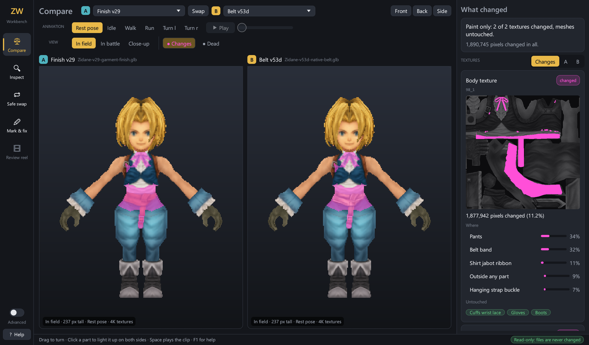
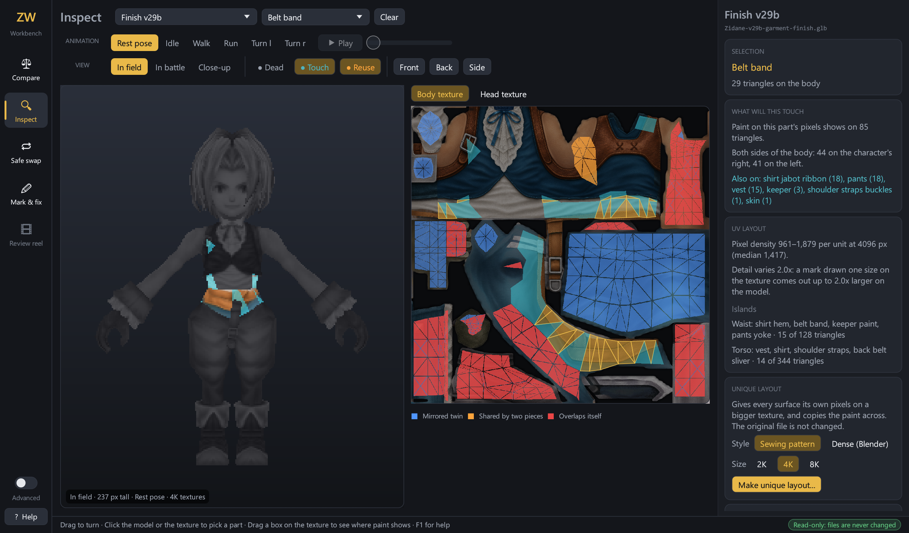
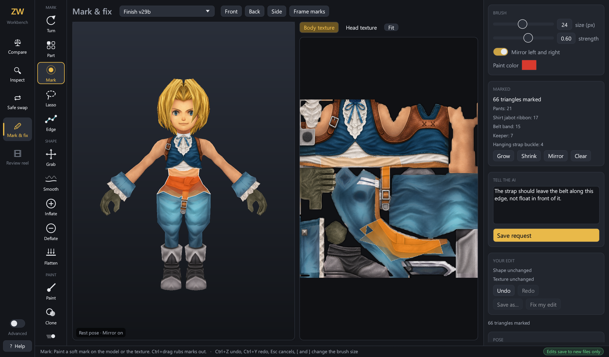

# Game Asset Workbench (GAW)

**Rust tools that AI assistants and people use to remaster 3D game assets: models, UVs and textures. Final Fantasy IX (Memoria engine) is the first game it supports.**

Compare two versions of a model, find every pixel and vertex that changed, unwrap it onto a clean sewing-pattern UV layout, and check an HD retexture before it goes near the game. Every tool runs from the command line and writes plain files and JSON, so an AI assistant can drive it, read the results and fix its own mistakes. People get a native egui/wgpu window for the same tools, including a page for marking what is wrong so the AI knows where to look.

Today it is built and tested on Final Fantasy IX character GLB exports. The GLB, UV, render and texture code has nothing FF9-specific in it, and the goal is every kind of asset in any game: characters, props and scenes.



*Compare: Finish v29 against Belt v53d at field size. 1,890,745 pixels changed, all of them paint. The panel says which parts of the model hold the changes and which parts are untouched.*

> **Not affiliated with Square Enix.** This repo ships no game data: no models, no textures, no extracted files. You bring your own legally obtained copy of the game. Final Fantasy is a trademark of Square Enix. The screenshots show the tool running on local exports from the author's own copy.

## What it does

- **Compare**: put an original model and a candidate side by side. Changed triangles turn magenta, dead triangles turn red, and a panel lists changed pixels per texture and per model part. Parts the candidate leaves alone get a green "Untouched" tag.
- **Inspect**: check one file. Click a part and see where it sits on the texture, how many triangles show the same pixels (so you know what a brush stroke will also paint), how dense the pixels are, and which parts mirror, stack or fold onto each other.
- **Safe swap**: drop a painted PNG into a copy of a GLB. The tool proves that only that texture changed (every other byte block, the JSON and every mesh match) and never overwrites a file.
- **Mark & fix**: mark what is wrong on the model or the texture, then either write a request an AI assistant can read (screenshot, masks, marked triangles by part) or make a rough edit yourself with shape and paint brushes and save it as a new file with the checks run for you.
- **Sewing-pattern UV layout** (`pattern`): cuts a model into pieces by body part, flattens each piece, stands it upright, pairs left and right pieces side by side and packs them at one texel density. Built in, no Blender needed. Stock folds and stacked mirror copies come apart, so every surface gets its own pixels.
- **Dense UV re-layout** (`relayout`): the older route. It runs a script in Blender 5.2 (headless) and copies the old paint across.
- **Paint projection bake** (`bake`): project a painted picture onto the texture atlas from a chosen camera, with guide, ID and depth images and a leak check.
- **Perceptual judge** (`judge`): compare two renders or two GLBs with LDR-FLIP and SSIM, scored per body part. It can store a set of golden views and check new candidates against them.
- **Hair tool** (`hair`): rebuild hair cards from a flow field with strand-aligned UVs and a strand synthesizer, plus checks across UV seams.
- **Strap tools** (`shells`, `strap-rebuild`, `strap-sweep`): find loose pieces of a mesh and rebuild a flat belt-strap card as a solid strap.
- **DXT shipping** (`ship`): write sheets as Memoria raw textures (DXT1, DXT5 or RGBA32 with a full mip chain). In progress, see [Limits](#limits-and-what-is-untested).
- **Byte-exact GLB writing**: a file written back from its parsed parts matches the input byte for byte (`roundtrip`).

| | |
|---|---|
|  |  |
| *Inspect: the belt band selected, with Touch and Reuse on. Teal triangles share pixels with the band, and colored texture areas are mirrored, shared or folded.* | *Mark & fix: 66 triangles marked with the soft brush and a note typed. The Marked card counts them by part.* |

All three screenshots are real captures of the window, taken with `gaw view ... --screenshot` on a hidden desktop. Nothing is a mockup.

## Build

You need a recent stable Rust toolchain (edition 2021) and a GPU driver that supports wgpu (DirectX 12, Vulkan or Metal). The window has only been run on Windows 11.

```bash
git clone https://github.com/finalpantasy/game-asset-workbench.git
cd game-asset-workbench
cargo build --release
```

The program is `target/release/gaw` (`.exe` on Windows). The first build downloads the libraries (egui, wgpu, image, rfd, spade) and takes a few minutes. A second small program, `zidane-inspector`, is the old name: it runs `gaw` from the same folder with the same arguments. The crate folder is still `crates/zidane-inspector`.

Run `cargo test --release` for the tests. Tests that need a local FF9 export skip themselves when the file is missing.

## Quick start

```bash
# Open the window on Compare
gaw

# Compare two GLBs in the terminal
gaw compare original.glb candidate.glb

# Open Inspect on one file with a part selected, and save a screenshot of the window
gaw view candidate.glb --part belt-band --touch --reuse --screenshot inspect.png

# Make a sewing-pattern UV layout (no Blender)
gaw pattern character.glb --out-dir NEW_FOLDER --size 4096
```

Keys in the window: Space plays or pauses, 1/2/3 pick field, battle or close-up, F/B/S turn the camera, D toggles dead triangles, C toggles changes, T and U toggle Touch and Reuse on Inspect, Ctrl+O opens a file, F1 opens Help.

## Commands

| Command | What it does |
|---|---|
| `view [file.glb]` | The window. With no file it opens Compare, with a file it opens Inspect. Options: `--page inspect\|compare\|swap\|mark`, `--a`, `--b`, `--clip`, `--time`, `--size field\|battle\|close`, `--part`, `--touch`, `--reuse`, `--region U0,V0,U1,V1`, `--texture`, `--changes`, `--dead`, `--tol N`, `--advanced`, `--screenshot out.png` |
| `compare a.glb b.glb` | What changed from A to B: pixels per texture and per part, meshes, skeleton, clips. `--tol N`, `--json` |
| `report [file.glb]` | Triangles, data arrays, joints, clips, dead triangles by body region, `--coverage SIZE` for unused texels |
| `uv [file.glb]` | UV islands with density, the texels two surfaces share, and with `--part` what painting that part touches |
| `swap in.glb --image NAME --png painted.png --out new.glb` | Safe swap with checks. Never overwrites |
| `pattern in.glb --out-dir DIR` | Sewing-pattern UV layout, pattern sheet, part, position and normal maps, `legend.json`, then the checks. Options include `--keep-stock`, `--orient-bones`, `--mirror-pairs`, `--metrics`, `--id-maps`, `--low-stretch` |
| `relayout in.glb --out-dir DIR` | Dense UV re-layout through Blender. `--check done.glb` only runs the checks |
| `bake file.glb --step guide\|register\|bake\|demo` | Paint projection bake onto the atlas |
| `judge REF TEST` | Perceptual check of two PNGs or two GLBs. Also `--make-goldens`, `--golden-dir`, `--strands` |
| `hair file.glb --out-dir DIR` | Hair card retexture and optional geometry rebuild |
| `shells`, `strap-rebuild`, `strap-sweep` | Loose-piece report, belt-strap rebuild, strap check sheets |
| `ship SHEET.png --out-dir DIR` | Write Memoria raw textures with mips |
| `requests [list\|show NAME]` | List and print the requests saved from Mark & fix |
| `requests locks NAME cand.glb` | Check a candidate against the places a request locked. Prints "Locks held", or the places that moved and exits 1 |
| `views [render cand.glb --out-dir DIR]` | List the saved inspection views, or render a candidate from each one, posed like the view |
| `roundtrip --out copy.glb` | Write the file back from its parsed parts and check it matches the input |
| `render --out view.png` | Save the model view and texture without opening a window |

Run `gaw help` for every option. Add `--json` to most commands for machine-readable output.

## How the comparison works

- Textures are matched by image name. Files with the same bytes count as unchanged without a pixel pass. Otherwise a pixel counts as changed when any channel differs by more than the tolerance (default 0). If the sizes differ, the smaller one is scaled up first.
- Meshes are matched by name. When vertex counts match, each vertex is checked for a new position or a new UV.
- A triangle shows as changed when a changed pixel lies inside its texture area or one of its vertices moved or got a new UV.
- A part is untouched when no changed pixel lies in its area of the part map and none of its triangles, on either side, is marked changed.

## Sewing-pattern layout

`pattern` turns a model into a layout a person or an AI can read like a sewing pattern. It is all Rust in `wb-core` (`pattern.rs`, `flatten.rs`, `rebuild.rs`, `font.rs`).

1. **Cut.** Each triangle gets a body part from the bone with the most weight. Pieces are the stock UV islands split where the part changes.
2. **Flatten.** Each piece is unfolded with least-squares conformal maps (LSCM). A closed ring such as a hat, sleeve or boot is cut like a tailor would cut it, into front and back panels and then across, until the flat piece no longer lies on itself.
3. **Straighten.** Each piece turns so the body's up points up the page.
4. **Scale.** One texel density for the whole model, with a higher factor for the head and hands.
5. **Pair.** Left and right pieces of the same part sit side by side.
6. **Pack.** Rows by part, with a name strip above each piece, at the largest scale where every sheet fits.
7. **Paint.** The old paint is copied through each triangle, then bled outward into the gaps.

It writes the new GLB and sheets, plus a labeled pattern sheet with numbered seams and a `legend.json`, and runs checks: same skeleton, clips and triangle counts, no texel on two surfaces, and renders from four sides that match the input.

In the author's runs on Final Fantasy IX characters, Vivi's 67 pieces and 100 seams took 5.3 s at 4096 px, and texels shown on two surfaces went from 623,097 to 0 on the body sheet. Zidane took 8.6 s. Render difference against stock stayed under 2.3 of 255 at the worst of four views.

## Expects a local FF9 export

Several defaults point at a local FF9 modding folder. Nothing here changes what the code does with them, but on another machine you must pass your own paths or the matching feature will not find its files.

| Where | Hard-coded default |
|---|---|
| `crates/zidane-inspector/src/main.rs` | `STOCK`: a stock Zidane export under `...\FINAL FANTASY IX\Modding\exports\`, used when a command gets no file. `KIT_PARTS`: the UV kit's part maps under `...\Modding\experiments\zidane-uv-kit-claude-v1\parts` (override with `--parts DIR`) |
| `crates/zidane-inspector/src/doc.rs` | The Compare pickers list seven known candidate GLBs under `...\Modding\experiments\` |
| `crates/zidane-inspector/src/requestcmd.rs` | `REQUESTS_DIR` (`...\Modding\workbench\requests`), `MODDING`, and the goldens folder `...\Modding\experiments\goldens\zidane` |
| `crates/zidane-inspector/src/swapjob.rs` | `GAME_ROOT`, the installed game folder. Safe swap refuses to write into it unless the path is under `Modding` |
| `crates/zidane-inspector/src/relayoutjob.rs` | Blender is searched for under `C:\Program Files\Blender Foundation` |
| `crates/wb-core/src/edit.rs`, `crates/wb-core/tests/*.rs` | Test fixtures under the same Modding folder. Each test skips when its file is missing |

The part names (belt band, jabot ribbon, gloves, and so on) come from a UV kit of part-ID maps that is **not** included, because it is derived from game textures. Without it, part tables fall back to numbers or bone names. Mark & fix's "Save as" refuses paths outside the hard-coded `Modding` folder, and "Save request" writes to the hard-coded requests folder unless you pass `--requests-dir DIR`.

The cleanest fix for a second game or a second machine is to move these constants into a config file. That is the first item on the to-do list.

## Limits and what is untested

- Windows 11 only. Other platforms have not been built or run.
- Developed against one game's character exports (Zidane and Vivi). Other FF9 characters and other games are untested, and part names need your own part maps.
- The battle-size view (160 px tall) is an estimate. The field size (237 px) was measured in one game frame.
- A triangle gets the part under its texture centroid, so triangles that cross a part edge go to one side.
- Clicking was checked with `--click-model`, not a real mouse. The window has only run on a hidden desktop.
- Nothing produced here has been loaded back into the game, except a private test of one pattern layout. Safe swap, the pattern layouts, the strap rebuild and the hair rebuild all need a game-side check before anyone calls them done.
- `ship` (Memoria raw textures with DXT1/DXT5) is in progress. The encoder and the decode-back check exist, but the output has not been tested in the game.
- `bake` works on a self-test and on masks. Local warp registration of a painted picture is an open gap.
- `judge --strands` separates hair versions from each other. It does not score absolute hair quality, and its limits are provisional.
- The "Review reel" page on the rail is a placeholder.

## Status and contributing

This is a working tool from an active modding project, published as it is. Issues and pull requests are welcome, especially for moving the hard-coded paths into a config file, running on Linux and macOS, and testing other characters. Please keep game data out of pull requests: no GLB, FBX or game PNG files. The `.gitignore` blocks the common ones.

## Layout

- `crates/wb-core`: GLB parsing and byte-exact writing, skinning and clips, mesh checks, comparison, CPU renderer, pattern layout, hair, bake, perceptual metrics.
- `crates/zidane-inspector`: the command line and the egui window (wgpu backend). `app.rs` holds the pages, `viewport.rs` the model views, `doc.rs` file loading, `theme.rs` the look.
- `tools/uv_relayout.py`: the Blender script behind `relayout`.

## License

MIT, see [LICENSE](LICENSE). Final Fantasy IX and its assets belong to Square Enix. This project is not affiliated with or endorsed by Square Enix or the Memoria project.
